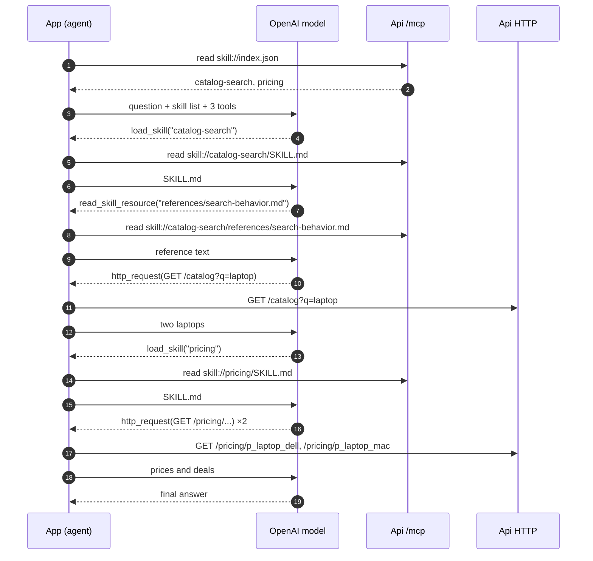

# {{title}}

*{{date | readableDate }}*

The Microsoft Agent Framework supports discovering skills from Model Context Protocol (MCP) servers in .NET (see [Discover Agent Skills from MCP servers in .NET](https://devblogs.microsoft.com/agent-framework/discover-agent-skills-from-mcp-servers-in-net/))[cite: 4]. This post demonstrates a key practical application: **making web APIs natively consumable by AI clients[cite: 4].**

OpenAPI specs and 1:1 MCP tools describe endpoint signatures, but omit multi-step task orchestration[cite: 4]. Agent Skills bridge this gap by publishing task-level playbooks alongside endpoints, enabling skill-aware AI clients to execute complex workflows without hard-coding domain logic[cite: 4].

---

## What an API Description Gives an AI Client

An OpenAPI definition for a pricing endpoint describes parameters and responses[cite: 4]:

```yaml
/pricing/{productId}:
  get:
    parameters:
      - name: productId
        in: path
        required: true
        schema: { type: string }
    responses:
      "200":
        description: OK
        content:
          application/json:
            schema: { $ref: "#/components/schemas/PriceQuote" }
      "404":
        description: Not Found

```

Exposed directly as an MCP tool, it simply becomes `get_pricing(productId: string)`. While accurate for human developers, it leaves critical AI operational questions unanswered:

* **ID Resolution:** Users request products by name ("Dell laptop"), not internal IDs (`p_laptop_dell`).


* **Orchestration:** API descriptions do not specify call sequences or parameter flow between endpoints.


* **Interpretation:** Business logic (e.g., handling null promotions or formatting discounts) is omitted.


* **Search Fallbacks:** Guidance on query formatting and zero-match recovery is missing.


API surfaces describe **granular operations**; AI clients require **end-to-end tasks**.

---

## What a Skill Adds

A skill provides explicit task guidance for AI models. Here is the `pricing` skill playbook:

```markdown
---
name: pricing
description: Get the list price, active promotion, and final discounted price for a product by its id. Use when the user asks how much a product costs or whether it is on sale.
---

# Pricing

## Endpoint

`GET /pricing/{productId}` on the same host that serves this MCP endpoint.

`productId` must be an exact product id such as `p_laptop_dell`. Names and free text are not accepted. If you only
have a name or description, find the id first with the `catalog-search` skill.

...

## Workflow

1. Resolve the product id (from earlier search results, or by searching the catalog).
2. Call the endpoint.
3. Quote `finalPrice` to the user. When `discountPct` is above 0, also mention the list price, the discount, and
   the promo name.

```

Key additions over raw API specifications:

* **Trigger Intent:** Frontmatter metadata tells the model *when* to activate the skill.


* **Orchestration Rules:** Instructs the model to resolve product IDs via `catalog-search` before calling `/pricing/{productId}`.


* **Output Formatting:** Dictates how to present pricing and discount details to users.


* **Progressive Context:** Reference documents (e.g., `references/search-behavior.md`) are loaded on demand.


The API spec defines the contract; the skill teaches the model how to execute it.

### Fewer Tokens as a Bonus

1:1 MCP tool bindings inject every tool's name, description, and schema into the prompt on every turn, scaling token overhead linearly with API size.

Agent Skills minimize overhead via progressive disclosure: the model receives compact skill metadata (~20–30 tokens each) and three fixed tools (`load_skill`, `read_skill_resource`, `http_request`). Detailed playbooks load only when required.

| Dimension | MCP Tool per Endpoint | Co-Hosted Skills + Generic HTTP Tool |
| --- | --- | --- |
| **What the client learns** | What each operation accepts and returns

 | How to orchestrate operations to complete a task

 |
| **Upfront prompt footprint** | Every tool's name, description, and JSON schema

 | Compact skill names and descriptions (`skill://index.json`)

 |
| **Tools registered on model** | One per endpoint, growing with the API surface

 | Three fixed tools (`load_skill`, `read_skill_resource`, `http_request`)

 |
| **Detailed guidance** | Embedded in tool schemas, sent on every call

 | Stored in `SKILL.md` and reference files, loaded on demand

 |

---

## Host the Skills with the API

APIs are the natural host for their own skills. In ASP.NET Core, REST endpoints and MCP skill resources co-exist within the same web application:

```text
Api/
├── Program.cs             ← HTTP endpoints + MCP endpoint
├── Data/                  ← Catalog and pricing logic
└── Skills/
    ├── catalog-search/
    │   ├── SKILL.md
    │   └── references/search-behavior.md
    └── pricing/
        └── SKILL.md

```

```csharp
var skillPackages = McpServerSkillPackage
    .CreateFromSubdirectories(Path.Combine(AppContext.BaseDirectory, "Skills"));

builder.Services
    .AddMcpServer(options => options.ServerInfo = new Implementation { Name = "Shopping", Version = "1.0.0" })
    .WithHttpTransport()
    .WithResources([SkillIndex.CreateResource(skillPackages)])
    .WithSkillPackages(skillPackages);

var app = builder.Build();

// Standard REST API endpoints
app.MapGet("/catalog", (Catalog catalog, string? q, decimal? maxPrice) => catalog.Search(q, maxPrice));
app.MapGet("/pricing/{productId}", (Pricing pricing, string productId) => ...);

// MCP endpoint serving the skills
app.MapMcp("/mcp");

```

Co-hosting advantages:

* **Synchronized Deployments:** API changes and skill playbook updates deploy in the same commit.


* **Domain Ownership:** API authors maintain the workflow documentation.


* **Zero Extra Infrastructure:** MCP routes alongside standard REST endpoints (e.g., `/mcp`). Relative paths resolve seamlessly.


* **Backward Compatible:** Standard REST consumers remain unaffected.


> **Implementation note:** The framework client discovers skills via `skill://index.json`. Use `SkillIndex.cs` to serve this index resource:
> 
> 

```json
{
  "skills": [
    { "name": "catalog-search", "type": "skill-md", "description": "Search the product catalog ...", "url": "skill://catalog-search/SKILL.md" },
    { "name": "pricing",        "type": "skill-md", "description": "Get the list price ...",        "url": "skill://pricing/SKILL.md" }
  ]
}

```

---

## An AI Client That Uses Them

The client agent operates without domain-specific code. It connects over MCP, registers skills, and executes calls through a generic HTTP tool sharing the API's `BaseAddress`:

```csharp
var mcpClient = await McpClient.CreateAsync(
    new HttpClientTransport(new HttpClientTransportOptions { Name = "api", Endpoint = _endpoint },
                            _httpClient, loggerFactory));

var skillsProvider = new AgentSkillsProviderBuilder()
    .UseMcpSkills(mcpClient)
    .DisableCaching()
    .UseOptions(options =>
    {
        options.DisableLoadSkillApproval = true;
        options.DisableReadSkillResourceApproval = true;
    })
    .Build();

return chatClient.AsAIAgent(new ChatClientAgentOptions
{
    ChatOptions = new ChatOptions
    {
        Instructions = "You are a helpful shopping assistant.",
        Tools = [AIFunctionFactory.Create(SendAsync, name: "http_request", description: "...")],
    },
    AIContextProviders = [skillsProvider],
});

```

The generic `http_request` tool handles root-relative requests (e.g., `/catalog`), allowing the same agent to target any skill-enabled API without code modifications.

---

## Skills in Action

Execution flow for *"What laptops do you have, and is either on sale?"*:



1. **Index Discovery:** Model receives only skill names and descriptions from `skill://index.json`.


2. **On-Demand Loading:** Model invokes `load_skill("catalog-search")` and fetches reference files as needed.


3. **Catalog Search:** Model calls `http_request(GET /catalog?q=laptop)` to retrieve product IDs.


4. **Skill Chaining:** Model loads `pricing` skill, using search output IDs to query `/pricing/{productId}`.


5. **Formatted Output:** Results match the skill's formatting playbook:


> We have two laptops:
> * **Dell XPS 13** — **$899.10**, on sale for **10% off** (list price $999) during the **Summer Sale**
> * **MacBook Air M3** — **$1,199**, not currently on sale
> 
> 

Pricing, discount details, and promos are output according to `pricing/SKILL.md` rules without custom agent code.

---

## Three Things That Tripped Me Up

* **Attach Providers to Agent, Not Chat Client:** Use `ChatClientAgentOptions.AIContextProviders`. Attaching to the chat client directly causes execution errors for `load_skill`.


* **Configure Skill Approval:** Set `DisableLoadSkillApproval = true` for trusted first-party servers to prevent tool execution pauses.


* **Provide Execution Tools:** Skills provide instructions, not execution. Pair skills with generic tools like `http_request` to enable model action.


---

## Wrapping Up

API descriptions specify endpoint contracts; Agent Skills define operational workflows. Co-hosting skills within the API web application ensures version alignment, simplifies infrastructure, lowers upfront token consumption, and makes APIs instantly consumable by AI clients.

```

```


[Complete sample code](https://github.com/StormHub/stormhub/tree/main/resources/2026-11-16)